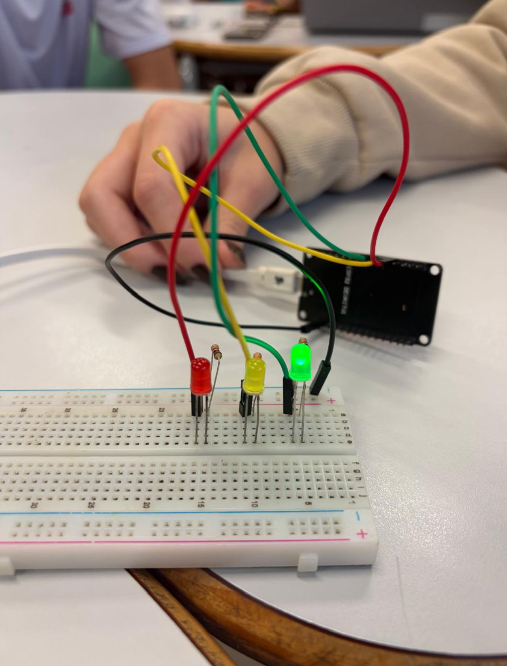
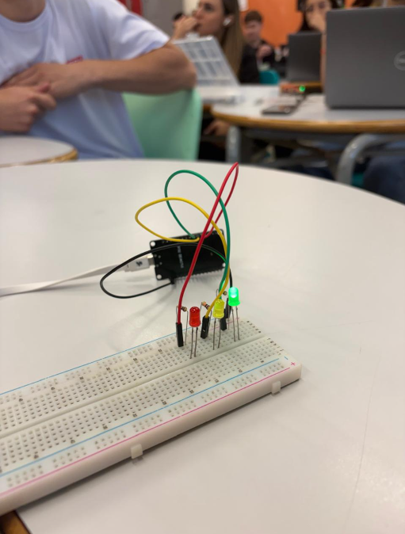
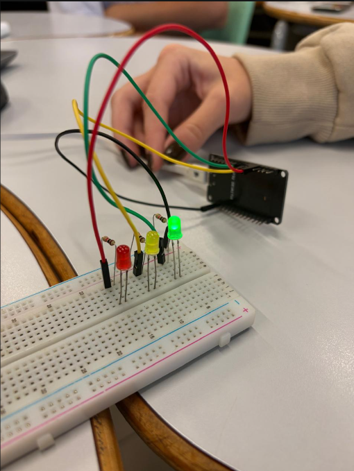

# Imagens projeto IOT - Semáforo
Projeto IOT com arduino físico de luzes de um semáforo.

## Participantes
Natalia Marangoni, Alice Costa, Murilo Chiarello, Nicollas Felisbelo e Mathias Pereira

## Imagens

| :-: | :-: | :-: |
|  |  |  |
